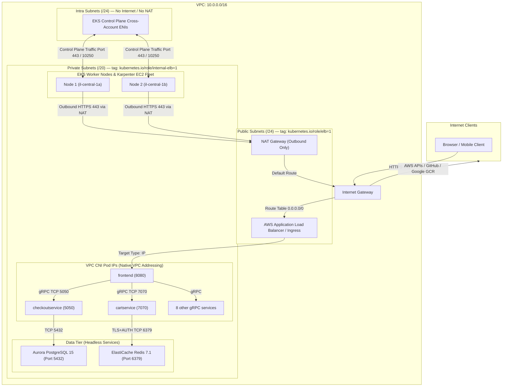
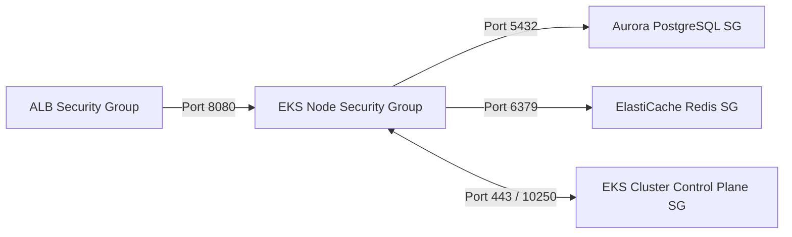

# Networking Architecture Deep-Dive — Online Boutique on AWS EKS

This document provides a comprehensive breakdown of the networking architecture implemented in this project. It covers VPC topology, subnet allocation, security group chaining, routing tables, and end-to-end traffic flows for preparing for Senior DevOps and Cloud Architect interviews.

---

## 1. Network Topology Overview

The infrastructure resides in a custom Amazon Virtual Private Cloud (VPC) spanning **3 Availability Zones** in the `il-central-1` (Israel Tel Aviv) region, configured with strict three-tier subnet segregation:

```text
VPC CIDR: 10.0.0.0/16 (dev) | 10.1.0.0/16 (prod) — Total 65,536 IPs
│
├── Public Subnets (x3 AZs)    [10.0.48.0/24, 10.0.49.0/24, 10.0.50.0/24]   — ALBs & NAT Gateways
├── Private Subnets (x3 AZs)   [10.0.0.0/20,  10.0.16.0/20, 10.0.32.0/20]   — EKS Nodes, Aurora, Redis
└── Intra Subnets (x3 AZs)     [10.0.52.0/24, 10.0.53.0/24, 10.0.54.0/24]   — EKS Control Plane ENIs
```

---

## 2. Mermaid Networking Architecture Diagram



---

## 3. Subnet Sizing & Design Rationale

| Subnet Class | CIDR Mask | Usable IPs per Subnet | Total Across 3 AZs | Purpose | Internet Route |
|---|---|---|---|---|---|
| **Private Subnets** | `/20` | ~4,091 IPs | **12,273 IPs** | EKS Worker Nodes, Pods (via VPC-CNI Prefix Delegation), Aurora DB, ElastiCache Redis | Routes `0.0.0.0/0` to **NAT Gateway** |
| **Public Subnets** | `/24` | ~251 IPs | **753 IPs** | Public ALBs, Ingress Load Balancers, NAT Gateways | Routes `0.0.0.0/0` to **Internet Gateway** |
| **Intra Subnets** | `/24` | ~251 IPs | **753 IPs** | EKS Control Plane ENIs | **None** (Isolated, internal routing only) |

> [!NOTE]
> **Why `/20` for Private Subnets?**
> AWS VPC CNI assigns **native secondary IP addresses** from the subnet directly to every Kubernetes pod. With Prefix Delegation enabled (`ENABLE_PREFIX_DELEGATION=true`), each EC2 node requests blocks of 16 IPs (`/28`). Sizing private subnets at `/20` (~4,096 IPs per AZ) prevents subnet IP exhaustion when Karpenter scales up dozens of worker nodes running hundreds of microservice pods.

> [!NOTE]
> **Why Separate "Intra" Subnets?**
> AWS manages the EKS control plane inside a private AWS-owned account and attaches Elastic Network Interfaces (ENIs) into your VPC. Placing these control plane ENIs in dedicated **Intra subnets** (which have no routes to NAT or Internet Gateways) creates total network isolation for cluster administrative traffic.

---

## 4. Subnet Tagging for Kubernetes Discovery

The subnets are tagged with standard AWS cloud-provider discovery tags:

| Subnet Tag Key | Value | What Uses It |
|---|---|---|
| `kubernetes.io/role/elb` | `1` | AWS Load Balancer Controller uses this to automatically discover which public subnets can host Internet-facing ALBs/NLBs. |
| `kubernetes.io/role/internal-elb` | `1` | AWS Load Balancer Controller uses this to place private/internal load balancers. |
| `karpenter.sh/discovery` | `online-boutique-dev` | Karpenter NodePool uses this tag to identify which private subnets it is allowed to launch EC2 worker instances into. |

---

## 5. Security Group Chaining Matrix

In production cloud architecture, security groups should **never rely on static CIDR ranges (`0.0.0.0/0` or `10.0.0.0/16`) for internal services**. Instead, this project uses **Security Group Chaining (Referencing peer Security Group IDs)**:



### Detailed Rules Table:

| Security Group | Inbound Allowed | Inbound Ports | Source | Outbound Allowed |
|---|---|---|---|---|
| **ALB Security Group** | Internet / Public | `80`, `443` | `0.0.0.0/0` | `8080` (Node SG / Pods) |
| **EKS Node SG** (`sg-node`) | ALB SG | `8080` | `sg-alb` | `0.0.0.0/0` (via NAT Gateway) |
| | Self (Node-to-Node) | All ports | `sg-node` | |
| | EKS Cluster SG | `10250` (Kubelet exec/logs) | `sg-cluster` | |
| **EKS Cluster SG** (`sg-cluster`) | Node SG | `443` (API Server) | `sg-node` | Any (Internal communication) |
| **Aurora PostgreSQL SG** (`sg-aurora`) | Node SG | `5432` | `sg-node` | `0.0.0.0/0` |
| **ElastiCache Redis SG** (`sg-redis`) | Node SG | `6379` | `sg-node` | `0.0.0.0/0` |

> [!TIP]
> **Interview Talking Point:**
> *"Aurora and Redis do not accept traffic from a CIDR range. They only permit connections originating from network interfaces carrying the EKS Node Security Group ID (`var.eks_node_security_group_id`). Even if an unauthorized instance exists in the same subnet, it cannot communicate with the database."*

---

## 6. End-to-End Traffic Paths

### A. Inbound User Request to Storefront (`/`)
1. **DNS Resolution:** Client queries `boutique.example.com` (resolved to the AWS Application Load Balancer DNS).
2. **ALB Ingress:** Client connects over HTTPS (port 443) to the ALB in the **Public Subnet**.
3. **Target Routing:** The AWS Load Balancer Controller uses `target-type: ip`. The ALB bypasses kube-proxy and routes the packet **directly to the pod's private IP** in the Private Subnet on port `8080`.
4. **Zero NodePort Overhead:** Direct pod targeting eliminates double-hops and SNAT latency.

### B. Microservice-to-Microservice (Internal gRPC Mesh)
1. **Frontend to Cart Service:** When a user clicks "Add to Cart", the `frontend` pod queries CoreDNS for `cartservice.online-boutique.svc.cluster.local`.
2. **Direct Pod Networking:** CoreDNS returns the Service ClusterIP (or headless endpoint). The packet travels over the AWS VPC network directly between worker nodes on port `7070` using gRPC HTTP/2.
3. **No NAT/Internet Transit:** All inter-pod traffic remains strictly inside the private VPC fabric.

### C. State Persistence & Caching
1. **Cart Storage:** `cartservice` connects to the ElastiCache Redis primary endpoint (`*.cache.amazonaws.com:6379`) over TLS. Authentication token is injected as an environment variable via External Secrets.
2. **Order Placement:** `checkoutservice` connects to the Aurora PostgreSQL cluster writer endpoint (`*.rds.amazonaws.com:5432`). Security group rules verify the node identity, and the transaction is committed across Multi-AZ storage.

### D. Outbound Internet Egress (Container Images, GitHub, OS Updates)
1. Worker nodes in Private Subnets needing external communication (pulling images from Google's GCR, downloading ArgoCD manifests from GitHub) route outbound traffic to the **NAT Gateway** in the Public Subnet.
2. The NAT Gateway performs Source Network Address Translation (SNAT), replacing the private IP with its Elastic IP, and forwards the packet out through the **Internet Gateway (IGW)**.

---

## 7. Senior DevOps Interview Q&A on This Architecture

#### Q1: Why did you choose AWS VPC CNI over Calico or Flannel?
> *"AWS VPC CNI assigns native VPC IP addresses to every pod directly from our VPC subnets. This means pods are first-class citizens in our AWS network: ALBs can route traffic directly to pod IPs without NodePort or kube-proxy hops, AWS VPC Flow Logs can monitor individual pod traffic, and AWS Security Groups can be assigned directly to pods if needed."*

#### Q2: How did you solve the pod density limitation on small EC2 instances?
> *"Standard VPC CNI limits the number of pods on an EC2 instance to the number of secondary IPs supported by the instance's network interfaces. We enabled **VPC CNI Prefix Delegation** (`ENABLE_PREFIX_DELEGATION=true` and `WARM_PREFIX_TARGET=1`). Instead of requesting single IPs, each ENI allocates a `/28` prefix (16 IPs at once), allowing even an `m5.large` or `t4g.medium` instance to run up to 110 pods without exhausting instance ENI limits."*

#### Q3: What is the difference between single NAT Gateway (dev) and Multi-NAT Gateway (prod)?
> *"In our dev environment, we set `single_nat_gateway = true` to route all private subnet outbound traffic through a single NAT in AZ-a, saving ~$65/month in AWS NAT gateway hourly fees. In prod, we configure a dedicated NAT Gateway per Availability Zone (`single_nat_gateway = false`). This eliminates cross-AZ data transfer fees and ensures that an outage in one AZ's NAT does not impact outbound connectivity for nodes in the other two AZs."*

#### Q4: Why are EKS Control Plane ENIs placed in "Intra" subnets?
> *"Intra subnets have route tables that route traffic strictly within the VPC with no default route (`0.0.0.0/0`) to an Internet Gateway or NAT Gateway. This ensures that the ENIs AWS provisions to connect our VPC to the managed EKS control plane are completely air-gapped from the Internet."*
